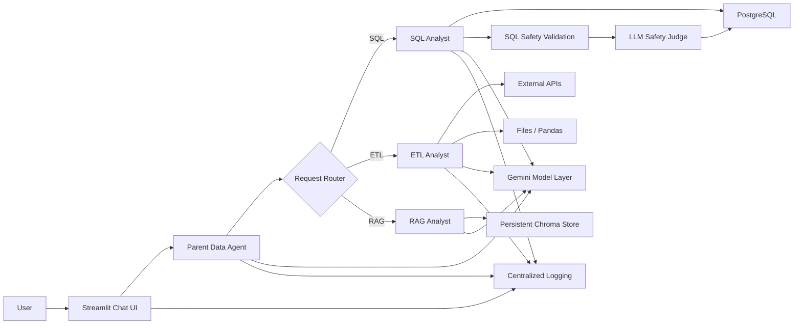
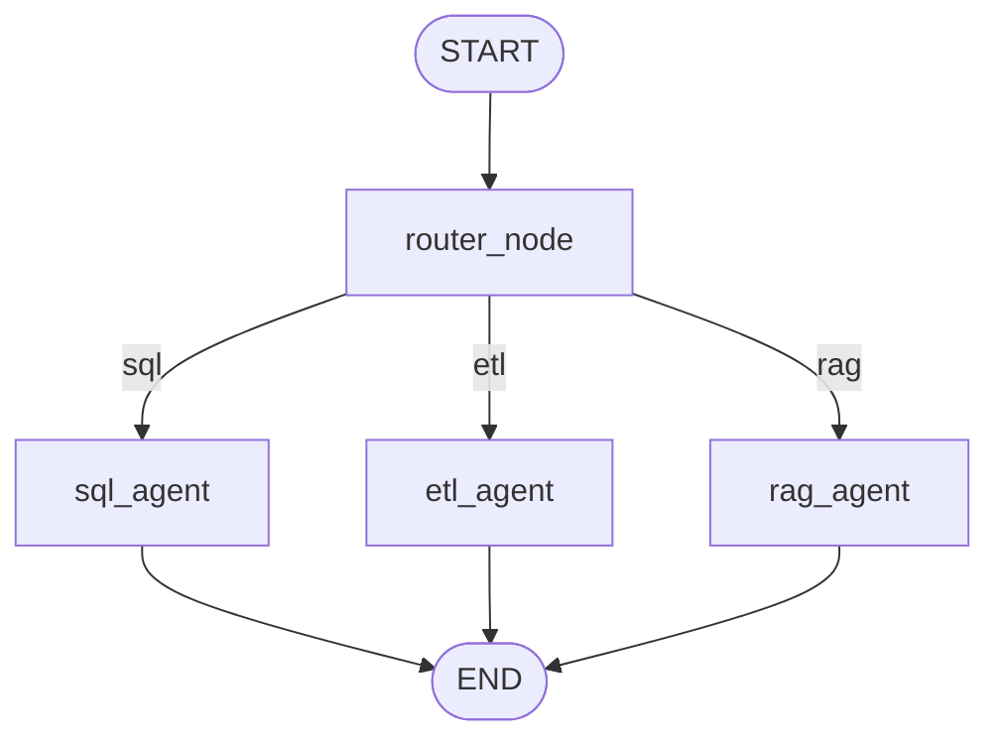
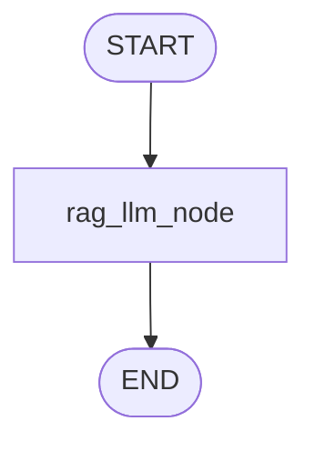
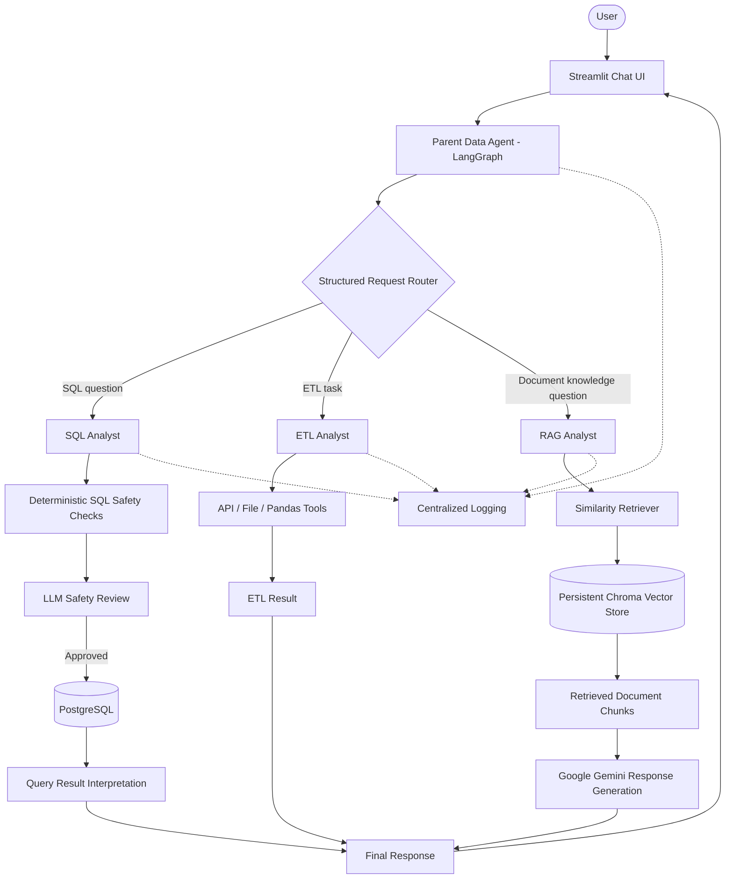
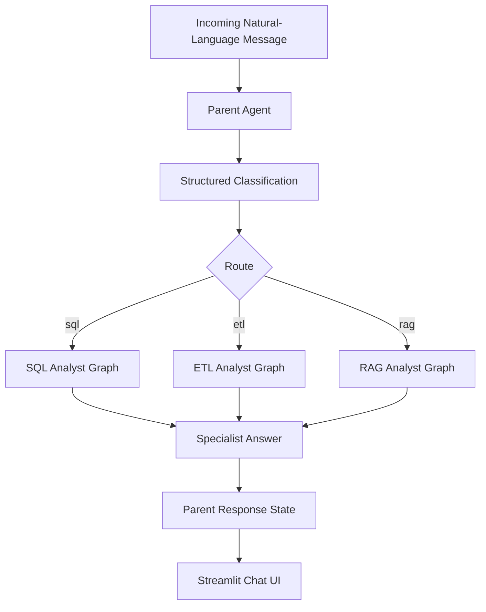
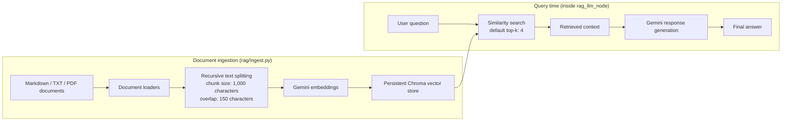
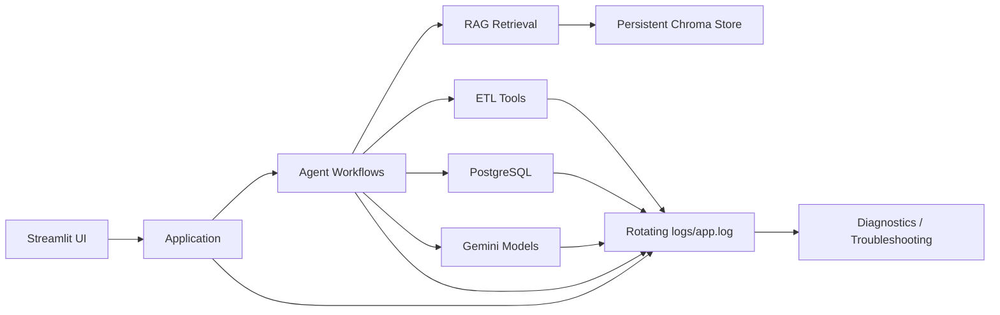

# Agentic Data Intelligence Platform

A Python-based, agent-driven data intelligence platform for turning natural-language questions into actionable results across SQL analytics, ETL, and document-grounded RAG workflows. The system combines LLM-based reasoning, LangGraph orchestration, deterministic SQL safety validation, PostgreSQL schema introspection, API/file-based ETL tools, a persistent Chroma knowledge base, centralized logging, and a Streamlit chat interface.

## Overview

This project is designed to help users interact with transportation and payments data using natural language instead of writing SQL or manually coordinating ETL steps.

The platform currently provides three specialist workflows:

- **SQL Analyst** — interprets a business question, uses PostgreSQL schema metadata and sample data to generate SQL, validates that the query is safe and read-only, executes the approved query, and produces a final answer.
- **ETL Analyst** — selects extraction and transformation tools for API/file workflows and returns the result to the agent.
- **RAG Analyst** — retrieves relevant chunks from the persistent document knowledge base and uses the retrieved context to produce a grounded answer.
- **Data Agent / Parent Router** — classifies an incoming request as `sql`, `etl`, or `rag` and routes it to the appropriate specialist workflow.
- **Streamlit UI** — provides a ChatGPT-style interface for interacting with the Data Agent, including chat history, suggested questions, analyst/model metadata, model health checks, and user-friendly error handling.
- **Centralized logging** — application activity is written to both the console and a rotating `logs/app.log` file.

## Key Features

- Natural-language-to-SQL workflow
- Parent agent that routes requests to SQL, ETL, or RAG specialists
- Deterministic read-only SQL safety validation before execution
- Structured LLM judge for an additional SQL safety review
- PostgreSQL schema introspection and sample-data context
- CSV-driven PostgreSQL database population
- API extraction and Pandas transformation tools for ETL workflows
- Markdown, TXT, and PDF ingestion with persistent Chroma retrieval for RAG
- Gemini model tiers with centralized configuration
- Model fallback handling for unavailable/rate-limited models
- Retry handling for temporary service/server failures
- Streamlit chat interface with conversation history
- Suggested business questions from the welcome screen
- Live model status checks for configured Gemini tiers
- Response metadata showing analyst, model tier, and execution time
- Safe frontend error messages while detailed errors are retained in logs
- Centralized rotating file logging for application diagnostics
- Structured Pydantic agent state models

The platform currently supports three specialist paths:

- **SQL Analyst** — uses PostgreSQL schema and sample-data context to generate a query, apply deterministic read-only safety checks and an LLM safety review, execute an approved query, and interpret the results.
- **ETL Analyst** — selects extraction and transformation tools for API- and file-based workflows.
- **RAG Analyst** — retrieves relevant chunks from a local Chroma vector store and uses the retrieved context to generate an answer grounded in the configured knowledge base.



### LangGraph Orchestration

The parent diagram represents the compiled graph in `agents/data_agent.py`: its conditional edges select one specialist node and then end the run. The RAG workflow is a separate compiled graph with one node; query-time retrieval and response generation happen inside that node.





### End-to-end platform architecture



### Request-routing workflow



### RAG Data Flow

Ingestion and query-time retrieval are implemented in Python functions called by the RAG workflow; they are not separate LangGraph nodes.



### Observability Flow



### Architecture Notes

- **Streamlit** is the user-facing interaction layer.
- **Data Agent** provides top-level routing and orchestration.
- **SQL Analyst** handles schema-aware analytical requests.
- **ETL Analyst** handles extraction and transformation requests.
- **RAG Analyst** retrieves indexed document chunks and generates grounded responses.
- **LangGraph** manages the stateful specialist workflows.
- **Gemini** provides routing, reasoning, SQL generation, safety review, embeddings, and response synthesis.
- **PostgreSQL** provides structured source data and schema metadata.
- **Chroma** persists document embeddings and supports similarity retrieval. Ingestion uses 1,000-character chunks with 150-character overlap; query-time retrieval defaults to the top 4 chunks.
- **RAG ingestion and retrieval** are operations inside the ingestion workflow and `rag_llm_node`, not separate nodes in the RAG LangGraph.
- **Deterministic SQL validation** is the first safety boundary before database execution.
- **LLM safety judging** provides a second review layer for generated SQL.
- **Centralized logging** captures operational events without exposing API credentials.

### Graph Visualizations

The repository includes PNGs rendered from the compiled LangGraph definitions:

- [Parent Data Agent graph](data_agent_graph.png)
- [SQL Analyst graph](sql_analyst_graph.png)
- [ETL Analyst graph](etl_analyst_graph.png)
- [RAG Analyst graph](rag_agent_graph.png)

Regenerate all four images from the repository root with:

```bash
uv run python scripts/generate_graphs.py
```

The renderer uses LangChain's installed Mermaid PNG API; no additional Python package is required. Rendering requires network access to the Mermaid rendering service. Graph generation imports and compiles the agents but does not invoke LLMs, connect to PostgreSQL, run ETL tools, or ingest documents.

## Streamlit User Interface

The Streamlit application in [app.py](app.py) provides:

- ChatGPT-style conversation flow
- New Chat and session-based history
- Suggested business questions
- Access to SQL, ETL, and RAG workflows through the Data Agent
- Gemini LOW, MEDIUM, and HIGH model status
- Test All Models functionality
- Analyst/model/execution-time response metadata
- User-friendly error handling
- Custom responsive application styling

Run the UI with:

```bash
uv run streamlit run app.py
```

### Existing graph visualizations

The repository includes generated visualizations for the existing parent and specialist graphs:

| Graph | Preview |
|---|---|
| Parent Data Agent | [`data_agent_graph.png`](data_agent_graph.png) |
| SQL Analyst | [`sql_analyst_graph.png`](sql_analyst_graph.png) |
| ETL Analyst | [`etl_analyst_graph.png`](etl_analyst_graph.png) |

The Mermaid diagrams above document the high-level platform and RAG flow. The RAG workflow is implemented in code; a generated RAG graph image is not currently listed among the repository's graph PNGs.

## Technology Stack

- **Language:** Python 3.12+
- **Agent orchestration:** LangGraph
- **LLM and embeddings:** Google Gemini through LangChain integrations
- **Agent framework:** LangChain
- **Structured database:** PostgreSQL, `psycopg2`
- **Vector database:** Chroma with persistent local storage
- **Document ingestion:** LangChain Community loaders, PyPDF, text splitters
- **ETL and data processing:** Requests, Pandas
- **UI:** Streamlit
- **State and validation:** Pydantic / typed graph state
- **Configuration:** python-dotenv
- **Logging:** Python logging with rotating file output

## Repository Layout

```text
.
├── agents/
│   ├── __init__.py
│   ├── data_agent.py
│   ├── etl_analyst.py
│   ├── rag_agent.py
│   ├── scratch.py
│   └── sql_analyst.py
├── rag/
│   ├── __init__.py
│   ├── ingest.py
│   ├── retriever.py
│   └── vector_store.py
├── scripts/
│   └── generate_graphs.py
├── data/
│   └── load/                 # Seed CSV files for PostgreSQL
├── knowledge_base/
│   ├── documents/            # Add .md, .txt, and .pdf source documents here
│   └── chroma_db/            # Persistent local Chroma index
├── models/
│   └── schema.py             # Pydantic and routing schemas
├── rag/
│   ├── ingest.py             # Load, split, and index documents
│   ├── retriever.py          # Similarity retrieval helpers
│   └── vector_store.py       # Gemini embedding and Chroma configuration
├── utils/
│   ├── data/
│   │   └── extract/
│   ├── database.py
│   ├── etl_tools.py
│   ├── feed_db.py
│   ├── graph_visualization.py
│   └── llm_pick.py
├── logs/
│   └── app.log
├── app.py
├── logging_config.py
├── main.py
├── pyproject.toml
├── README.md
├── schema_info.txt
├── data_agent_graph.png
├── etl_analyst_graph.png
├── rag_agent_graph.png
├── sql_analyst_graph.png
├── etl_analyst_graph.png
├── pyproject.toml
├── uv.lock
└── README.md
```

## Getting Started

### Prerequisites

- Python 3.12 or later
- PostgreSQL instance and credentials for SQL/ETL features that use the database
- Google AI API key(s) required by your configured Gemini model and embedding integrations
- Git

### 1. Clone the repository

```bash
git clone https://github.com/swapniltake1/agentic-data-intelligence-platform.git
cd agentic-data-intelligence-platform
```

### 2. Create and configure environment variables

Create a `.env` file in the project root. Keep real credentials out of source control.

```env
# PostgreSQL — required for database-backed workflows
DB_HOST=localhost
DB_PORT=5432
DB_NAME=your_database_name
DB_USER=your_postgres_user
DB_PASSWORD=your_postgres_password

# Gemini / Google AI
GEMINI_API_KEY=your_gemini_api_key
GOOGLE_API_KEY=your_google_api_key

# Optional RAG configuration
# RAG_COLLECTION_NAME=ola_knowledge
# GOOGLE_EMBEDDING_MODEL=gemini-embedding-001
```

The RAG embedding factory currently reads `GOOGLE_API_KEY`. Configure the key according to the model and LangChain integration you are using. Never commit a real key.

### 3. Install dependencies

Using `uv` (recommended when available):

```bash
uv sync
```

Or install the project dependencies with pip:

```bash
python -m pip install -e .
```

### 4. Prepare the PostgreSQL data (SQL workflows)

Review the database configuration and CSV inputs, then run:

```bash
uv run python utils/feed_db.py
```

Use your configured environment and database permissions. Skip this step if you only intend to experiment with the document RAG path.

### 5. Add and index knowledge-base documents (RAG)

Place your source files under `knowledge_base/documents/`. Supported extensions are:

- `.md` — Markdown
- `.txt` — UTF-8 text
- `.pdf` — PDF documents

Build or rebuild the local vector index:

```bash
uv run python -m rag.ingest
```

The ingestion script loads the supported files, splits content into chunks (1,000 characters with 150 characters of overlap), creates deterministic chunk IDs, and indexes the chunks in the persistent Chroma collection at `knowledge_base/chroma_db/`.

**Note:** Re-running ingestion rebuilds the configured collection by deleting its existing entries before indexing the current document set. Back up the directory or use a separate collection if you need to preserve an existing index.

### 6. Launch the application

```bash
uv run streamlit run app.py
```

Then open the local URL printed by Streamlit. You can ask for SQL-backed analysis, ETL operations, or questions about the indexed documents.

## How to Use the RAG Feature

1. Add relevant business or domain documents to `knowledge_base/documents/`.
2. Set the Google AI key used by the embedding integration.
3. Run the ingestion command to build the Chroma index.
4. Launch the Streamlit application.
5. Ask a natural-language question about the indexed material. The parent agent should route document-knowledge questions to the RAG specialist.

The RAG agent uses similarity retrieval with a default `top_k` of 4. Retrieved text is passed as evidence to the response model; the prompt instructs the model to avoid unsupported claims and to state when the available context is insufficient. This does not replace testing retrieval quality or verifying important answers.

## Configuration Notes

- Gemini model-tier configuration is centralized in `utils/llm_pick.py`.
- The parent router is configured with the project's medium-tier base LLM.
- RAG response generation uses the configured medium-tier model.
- The RAG embedding model defaults to `gemini-embedding-001`; override with `GOOGLE_EMBEDDING_MODEL` if needed.
- The Chroma collection defaults to `ola_knowledge`; override with `RAG_COLLECTION_NAME`.
- The Chroma index is stored locally under `knowledge_base/chroma_db/`.

## Logging and Observability

Logging is configured through `logging_config.py` and is used across the application's agent workflows. The existing configuration supports console output and a rotating `logs/app.log` file, helping with troubleshooting without displaying detailed internal exceptions directly in the chat UI.

Do not log secrets, API keys, passwords, or confidential document content.

## Security and Operational Considerations

- **SQL access:** generated SQL passes deterministic checks intended to allow only a single read-only `SELECT` or `WITH` query, followed by an LLM safety review before execution. Use a least-privilege PostgreSQL account as an additional control.
- **ETL execution:** the ETL transformation utility uses Python `exec()`. Do not run untrusted or model-generated code in a production process without a restrictive sandbox and explicit controls.
- **Credentials:** keep `.env` out of version control and rotate any credentials accidentally exposed.
- **RAG quality:** retrieved content can be incomplete, outdated, or irrelevant. Keep knowledge documents curated and re-index after updates.
- **Local vector data:** treat the Chroma directory as application data; protect it according to the sensitivity of the indexed documents.
- **Production readiness:** authentication, authorization, isolation, automated evaluation, and comprehensive tests should be added before exposing the platform to untrusted users.

## Project Status

### Implemented

- [x] Parent LangGraph router for SQL, ETL, and RAG requests
- [x] SQL Analyst workflow with deterministic checks and LLM safety review
- [x] ETL Analyst workflow with API/file transformation tools
- [x] RAG ingestion for Markdown, text, and PDF sources
- [x] Text chunking and persistent Chroma indexing
- [x] Similarity retrieval and context-grounded Gemini responses
- [x] Streamlit conversational interface
- [x] Centralized LLM configuration and application logging

### Potential next steps

- Add automated unit and integration tests for routing, ingestion, retrieval, and SQL validation
- Add evaluation datasets for retrieval relevance and answer faithfulness
- Add source/page citations to RAG responses where appropriate
- Add a sandbox for ETL code execution
- Introduce authentication, authorization, and deployment configuration
- Add monitoring, traces, and stakeholder-facing reporting

## License

No license file is currently included. Unless a license is added to the repository, reuse and redistribution are not explicitly granted.
