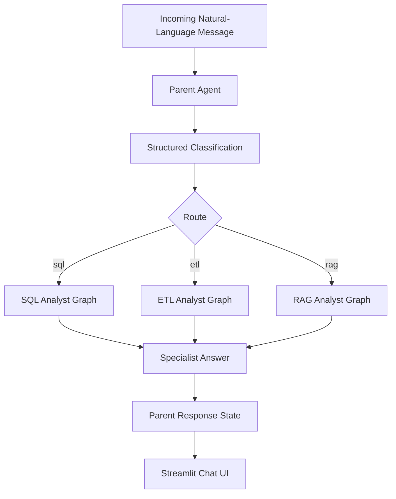
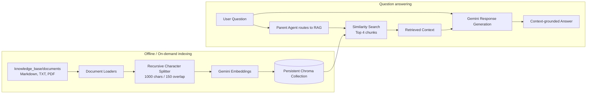
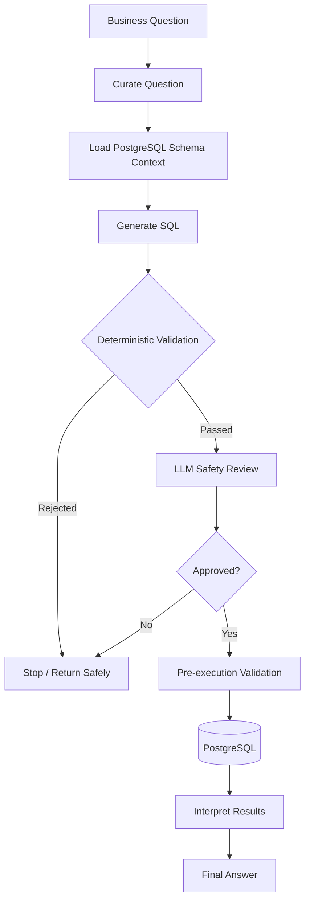

# Agentic Data Intelligence Platform

<p align="center">
  <strong>Natural-language access to structured data, ETL workflows, and document knowledge</strong>
  <br />
  A multi-agent platform powered by LangGraph, Google Gemini, PostgreSQL, Chroma, and Streamlit.
</p>

<p align="center">
  
  
  
  
  
  
</p>

---

## Overview

The **Agentic Data Intelligence Platform** is a conversational interface for asking questions across structured business data, extraction/transformation workflows, and document-based knowledge. A parent agent classifies each request and delegates it to a specialist workflow, so users can work in natural language instead of manually coordinating individual tools.

The platform currently supports three specialist paths:

- **SQL Analyst** — uses PostgreSQL schema and sample-data context to generate a query, apply deterministic read-only safety checks and an LLM safety review, execute an approved query, and interpret the results.
- **ETL Analyst** — selects extraction and transformation tools for API- and file-based workflows.
- **RAG Analyst** — retrieves relevant chunks from a local Chroma vector store and uses the retrieved context to generate an answer grounded in the configured knowledge base.

A Streamlit chat UI provides the interaction layer, while LangGraph coordinates request routing and specialist execution.

## Capabilities

| Capability | What it does |
|---|---|
| Multi-agent routing | Classifies questions as `sql`, `etl`, or `rag` and invokes the selected specialist |
| Natural-language SQL | Turns business questions into PostgreSQL queries using schema-aware context |
| SQL guardrails | Rejects unsafe or non-read-only SQL before execution, followed by an LLM review |
| Retrieval-Augmented Generation | Retrieves semantically similar document chunks and supplies them to the LLM as answer context |
| Document ingestion | Loads Markdown, text, and PDF files, splits them into chunks, and indexes them in Chroma |
| ETL tooling | Supports API extraction and file/Pandas transformation workflows |
| Gemini integration | Centralizes model configuration and supports the project's configured retry/fallback handling |
| Conversational UI | Offers a ChatGPT-style Streamlit chat experience with session-based conversation history |
| Operational logs | Writes application diagnostics to the console and rotating log files |

## Architecture

### End-to-end platform architecture


### Request-routing workflow



### RAG ingestion and retrieval workflow



The ingestion job rebuilds the configured Chroma collection from the documents directory. At query time, the RAG agent retrieves up to four similar chunks, combines them into context, and asks the configured Gemini model to answer. When the retrieved context is empty or insufficient, the agent is designed to report that limitation rather than intentionally invent unsupported facts.

### Guarded SQL workflow



### Existing graph visualizations

The repository includes generated visualizations for the existing parent and specialist graphs:

| Graph | Preview |
|---|---|
| Parent Data Agent | [`data_agent_graph.png`](data_agent_graph.png) |
| SQL Analyst | [`sql_analyst_graph.png`](sql_analyst_graph.png) |
| ETL Analyst | [`etl_analyst_graph.png`](etl_analyst_graph.png) |

The Mermaid diagrams above document the high-level platform and RAG flow. The RAG workflow is implemented in code; a generated RAG graph image is not currently listed among the repository's graph PNGs.

## Technology Stack

- **Language:** Python 3.12+
- **Agent orchestration:** LangGraph
- **LLM and embeddings:** Google Gemini through LangChain integrations
- **Agent framework:** LangChain
- **Structured database:** PostgreSQL, `psycopg2`
- **Vector database:** Chroma with persistent local storage
- **Document ingestion:** LangChain Community loaders, PyPDF, text splitters
- **ETL and data processing:** Requests, Pandas
- **UI:** Streamlit
- **State and validation:** Pydantic / typed graph state
- **Configuration:** python-dotenv
- **Logging:** Python logging with rotating file output

## Repository Layout

```text
.
├── agents/
│   ├── data_agent.py         # Parent router for SQL, ETL, and RAG
│   ├── sql_analyst.py        # Guarded natural-language-to-SQL workflow
│   ├── etl_analyst.py        # ETL specialist workflow
│   └── rag_agent.py          # Retrieval-grounded answer generation
├── data/
│   └── load/                 # Seed CSV files for PostgreSQL
├── knowledge_base/
│   ├── documents/            # Add .md, .txt, and .pdf source documents here
│   └── chroma_db/            # Persistent local Chroma index
├── models/
│   └── schema.py             # Pydantic and routing schemas
├── rag/
│   ├── ingest.py             # Load, split, and index documents
│   ├── retriever.py          # Similarity retrieval helpers
│   └── vector_store.py       # Gemini embedding and Chroma configuration
├── utils/
│   ├── database.py           # PostgreSQL access and schema utilities
│   ├── etl_tools.py          # ETL tools
│   ├── feed_db.py            # Database/CSV setup
│   └── llm_pick.py           # LLM configuration helpers
├── app.py                    # Streamlit chat UI
├── main.py                   # Lightweight application entry point
├── logging_config.py         # Centralized logging configuration
├── schema_info.txt           # Schema reference
├── data_agent_graph.png
├── sql_analyst_graph.png
├── etl_analyst_graph.png
├── pyproject.toml
├── uv.lock
└── README.md
```

## Getting Started

### Prerequisites

- Python 3.12 or later
- PostgreSQL instance and credentials for SQL/ETL features that use the database
- Google AI API key(s) required by your configured Gemini model and embedding integrations
- Git

### 1. Clone the repository

```bash
git clone https://github.com/swapniltake1/agentic-data-intelligence-platform.git
cd agentic-data-intelligence-platform
```

### 2. Create and configure environment variables

Create a `.env` file in the project root. Keep real credentials out of source control.

```env
# PostgreSQL — required for database-backed workflows
DB_HOST=localhost
DB_PORT=5432
DB_NAME=your_database_name
DB_USER=your_postgres_user
DB_PASSWORD=your_postgres_password

# Gemini / Google AI
GEMINI_API_KEY=your_gemini_api_key
GOOGLE_API_KEY=your_google_api_key

# Optional RAG configuration
# RAG_COLLECTION_NAME=ola_knowledge
# GOOGLE_EMBEDDING_MODEL=gemini-embedding-001
```

The RAG embedding factory currently reads `GOOGLE_API_KEY`. Configure the key according to the model and LangChain integration you are using. Never commit a real key.

### 3. Install dependencies

Using `uv` (recommended when available):

```bash
uv sync
```

Or install the project dependencies with pip:

```bash
python -m pip install -e .
```

### 4. Prepare the PostgreSQL data (SQL workflows)

Review the database configuration and CSV inputs, then run:

```bash
uv run python utils/feed_db.py
```

Use your configured environment and database permissions. Skip this step if you only intend to experiment with the document RAG path.

### 5. Add and index knowledge-base documents (RAG)

Place your source files under `knowledge_base/documents/`. Supported extensions are:

- `.md` — Markdown
- `.txt` — UTF-8 text
- `.pdf` — PDF documents

Build or rebuild the local vector index:

```bash
uv run python -m rag.ingest
```

The ingestion script loads the supported files, splits content into chunks (1,000 characters with 150 characters of overlap), creates deterministic chunk IDs, and indexes the chunks in the persistent Chroma collection at `knowledge_base/chroma_db/`.

**Note:** Re-running ingestion rebuilds the configured collection by deleting its existing entries before indexing the current document set. Back up the directory or use a separate collection if you need to preserve an existing index.

### 6. Launch the application

```bash
uv run streamlit run app.py
```

Then open the local URL printed by Streamlit. You can ask for SQL-backed analysis, ETL operations, or questions about the indexed documents.

## How to Use the RAG Feature

1. Add relevant business or domain documents to `knowledge_base/documents/`.
2. Set the Google AI key used by the embedding integration.
3. Run the ingestion command to build the Chroma index.
4. Launch the Streamlit application.
5. Ask a natural-language question about the indexed material. The parent agent should route document-knowledge questions to the RAG specialist.

The RAG agent uses similarity retrieval with a default `top_k` of 4. Retrieved text is passed as evidence to the response model; the prompt instructs the model to avoid unsupported claims and to state when the available context is insufficient. This does not replace testing retrieval quality or verifying important answers.

## Configuration Notes

- Gemini model-tier configuration is centralized in `utils/llm_pick.py`.
- The parent router is configured with the project's medium-tier base LLM.
- RAG response generation uses the configured medium-tier model.
- The RAG embedding model defaults to `gemini-embedding-001`; override with `GOOGLE_EMBEDDING_MODEL` if needed.
- The Chroma collection defaults to `ola_knowledge`; override with `RAG_COLLECTION_NAME`.
- The Chroma index is stored locally under `knowledge_base/chroma_db/`.

## Logging and Observability

Logging is configured through `logging_config.py` and is used across the application's agent workflows. The existing configuration supports console output and a rotating `logs/app.log` file, helping with troubleshooting without displaying detailed internal exceptions directly in the chat UI.

Do not log secrets, API keys, passwords, or confidential document content.

## Security and Operational Considerations

- **SQL access:** generated SQL passes deterministic checks intended to allow only a single read-only `SELECT` or `WITH` query, followed by an LLM safety review before execution. Use a least-privilege PostgreSQL account as an additional control.
- **ETL execution:** the ETL transformation utility uses Python `exec()`. Do not run untrusted or model-generated code in a production process without a restrictive sandbox and explicit controls.
- **Credentials:** keep `.env` out of version control and rotate any credentials accidentally exposed.
- **RAG quality:** retrieved content can be incomplete, outdated, or irrelevant. Keep knowledge documents curated and re-index after updates.
- **Local vector data:** treat the Chroma directory as application data; protect it according to the sensitivity of the indexed documents.
- **Production readiness:** authentication, authorization, isolation, automated evaluation, and comprehensive tests should be added before exposing the platform to untrusted users.

## Project Status

### Implemented

- [x] Parent LangGraph router for SQL, ETL, and RAG requests
- [x] SQL Analyst workflow with deterministic checks and LLM safety review
- [x] ETL Analyst workflow with API/file transformation tools
- [x] RAG ingestion for Markdown, text, and PDF sources
- [x] Text chunking and persistent Chroma indexing
- [x] Similarity retrieval and context-grounded Gemini responses
- [x] Streamlit conversational interface
- [x] Centralized LLM configuration and application logging

### Potential next steps

- Add automated unit and integration tests for routing, ingestion, retrieval, and SQL validation
- Add evaluation datasets for retrieval relevance and answer faithfulness
- Add source/page citations to RAG responses where appropriate
- Add a sandbox for ETL code execution
- Introduce authentication, authorization, and deployment configuration
- Add monitoring, traces, and stakeholder-facing reporting

## License

No license file is currently included. Unless a license is added to the repository, reuse and redistribution are not explicitly granted.
